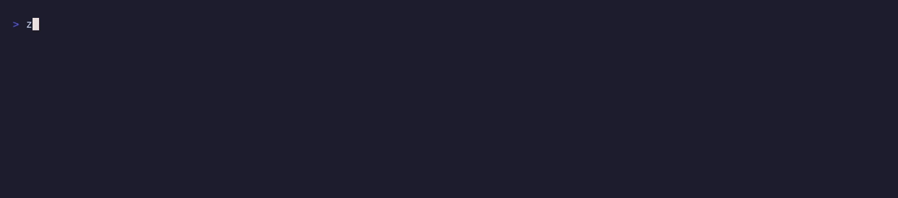

# ZombieScanner

[](https://github.com/Sachinxmpl/zombie-scanner/actions/workflows/ci.yml)
[](https://github.com/Sachinxmpl/zombie-scanner/releases/latest)
[](https://goreportcard.com/report/github.com/Sachinxmpl/zombie-scanner)
[](LICENSE)
[](SECURITY.md)

**Finds the AWS resources that are dead but still billing.**

A command-line tool that looks through your AWS account, lists the
resources nothing is using, and shows roughly what each one costs per month.
**It only reads. It never creates, changes or deletes anything.**



```console
$ zombie-scanner --all-regions
Account 123456789012 · us-east-1, eu-west-1 · scanned 2026-09-04 15:44 UTC

RESOURCE               TYPE         REGION      CONF    ~$/MO    REASON
nat-1fd0486ae1b9f4058  nat-gateway  eu-west-1   MEDIUM  $34.82   104799 bytes out over 14 days (checked 2026-09-04)
i-0de1d1d34a6dd890c    ec2-instance us-east-1   MEDIUM  $58.00   Stopped 171 days ago (t3.large); 2 attached volume(s) still billing
vol-01aa332c9f5cd7872  ebs-volume   us-east-1   HIGH    $8.00    Unattached; created 412 days ago (100 GiB gp3)
snap-09ea129477b096c4e ebs-snapshot us-east-1   LOW     $5.00    Created 412 days ago (100 GiB), not referenced by any AMI
eipalloc-02…968f11221f elastic-ip   us-east-1   HIGH    $3.65    Public IP 100.29.56.194 is allocated but associated with nothing

5 zombies · estimated zombie spend ~$109.47/month · figures are estimates
```

## Why

Every AWS resource bills one of two ways:

| Billing shape        | Meaning                                       | Cost when idle |
| -------------------- | --------------------------------------------- | -------------- |
| **Usage-billed**     | Charged for work done — Lambda calls, S3 GETs | ~$0            |
| **Existence-billed** | Charged for existing — EBS, NAT, Elastic IPs  | Full price     |

> **A zombie is an existence-billed resource that nothing is using.**

A volume detached during a migration eighteen months ago. A NAT gateway in a VPC
nobody deploys to any more. An Elastic IP left behind by a terminated instance.

None of them show up in a cost anomaly report, because nothing anomalous is
happening. They just bill, every hour, indefinitely.

## Install

**Go**

```bash
go install github.com/Sachinxmpl/zombie-scanner@latest
```

**Linux packages** (use `arm64` instead of `amd64` if needed)

```bash
VERSION=$(curl -s https://api.github.com/repos/Sachinxmpl/zombie-scanner/releases/latest \
  | grep -oP '"tag_name": "v\K[^"]+')
BASE=https://github.com/Sachinxmpl/zombie-scanner/releases/download/v${VERSION}

# Debian / Ubuntu
curl -sLO ${BASE}/zombie-scanner_${VERSION}_linux_amd64.deb
sudo dpkg -i zombie-scanner_${VERSION}_linux_amd64.deb

# RHEL / Fedora
sudo rpm -i ${BASE}/zombie-scanner_${VERSION}_linux_amd64.rpm

# Alpine
curl -sLO ${BASE}/zombie-scanner_${VERSION}_linux_amd64.apk
sudo apk add --allow-untrusted zombie-scanner_${VERSION}_linux_amd64.apk
```

**Ready-made binaries** for Linux, macOS and Windows are on the
[releases page](https://github.com/Sachinxmpl/zombie-scanner/releases).

**From source Code** (Go 1.25.14 or later)

```bash
git clone https://github.com/Sachinxmpl/zombie-scanner
cd zombie-scanner
make build
```

### Verifying the release

Each release comes with a checksum file and a GitHub attestation that proves
the file was built by this repository's release workflow:

```bash
sha256sum -c checksums.txt --ignore-missing
gh attestation verify zombie-scanner_*_linux_amd64.tar.gz --repo Sachinxmpl/zombie-scanner
```

## Quick start

Credentials come from the standard AWS chain — environment variables,
`~/.aws/config`, SSO, instance roles. If `aws sts get-caller-identity` works,
this works.

```bash
zombie-scanner                                  # your default region
zombie-scanner --region eu-west-1
zombie-scanner --all-regions
zombie-scanner --profile prod --all-regions
```

**Available Commands**
```bash
zombie-scanner [command]

  scan        Scan for zombie resources (default action)
  help        Help about any command
  detectors   List the available detectors
  iam-policy  Print the minimal IAM policy this tool needs
  render      Re-render a saved JSON report in another format
  version     Print the version
```

**Filters**

```bash
zombie-scanner --min-cost 10                    # only things costing over $10/month
zombie-scanner --confidence high                # only the surest findings
zombie-scanner --only ebs-unattached,nat-idle   # only these checks
zombie-scanner --skip snapshot-aged             # everything except this check
```

**Change the limits**

```bash
zombie-scanner --snapshot-age-days 180 --stopped-days 60 --idle-window-days 30
```

**See how each cost was derived**

```bash
zombie-scanner -v
```

Every flag can also be set with an environment variable:
```
ZOMBIE_SCANNER_MIN_COST=25 zombie-scanner --all-regions
```
Precedence is `flag > environment > config file > default`. A region set in the
environment or the config file is only a default: `--all-regions` still scans
every region.


## Hiding things you want to keep

Some "zombies" are on purpose, like a standby database. There are three ways to
stop seeing them.

**1. Tag the resource** with `zombie-scanner:keep`. Any value works; write why.

```bash
aws ec2 create-tags --resources vol-0abc --tags Key=zombie-scanner:keep,Value="DR standby"
```

Use `--keep-tag` to pick a different tag name, or `--no-keep-tag` to show
everything.

**2. Add an ignore rule** in `.zombie-scanner.yaml`. It reads from the current
folder first, then your home folder.

```yaml
min-cost: 1
idle-window-days: 30

ignore:
  - id: vol-0abc
    reason: kept for the quarterly restore test
  - detector: snapshot-aged
    region: eu-west-1
    reason: compliance keeps these for 7 years
```

Each rule needs a `reason` and at least one of `id`, `detector` or `region`. If a
rule matched nothing, the tool tells you, so old rules don't pile up. The file
can also hold your usual settings: `region`, `profile`, `output`, `min-cost`,
`confidence`, `keep-tag` and the three limits. A flag or environment variable
beats the file. Use `--no-config` to ignore the file.

**3. Point it at your Terraform state.** Anything Terraform manages is there on
purpose, so it is hidden:

```bash
zombie-scanner --tf-state ./terraform.tfstate
zombie-scanner --tf-state ./states/              # every .tfstate file in the folder
```

Whatever is hidden is counted at the bottom of the report, e.g. "3 hidden by
--min-cost", so nothing disappears silently.

## Several accounts

```bash
zombie-scanner --accounts 111111111111,222222222222 --all-regions
```

This scans your own account, plus each listed account by assuming the role
`ZombieScannerReadOnly` in it (change it with `--role-name`). That role needs the
policy from `zombie-scanner iam-policy` and must trust your account. With more
than one account, the report adds an Account column.

## What it checks

| Detector             | Confidence | What it looks for                              | Cost basis              |
| -------------------- | ---------- | ---------------------------------------------- | ----------------------- |
| `ebs-unattached`     | HIGH       | Volumes in state `available`                   | size × per-GiB rate     |
| `eip-unassociated`   | HIGH       | Elastic IPs attached to nothing                | flat monthly            |
| `efs-unused`         | HIGH       | File systems with no mount targets             | size × per-tier rate    |
| `kms-key-disabled`   | HIGH       | Disabled customer-managed encryption keys      | flat $1/key             |
| `rds-stopped`        | HIGH       | Stopped databases still paying for storage     | allocated GiB × rate    |
| `instance-stopped`   | MEDIUM     | Stopped instances still paying for disks, IPs  | volumes + Elastic IPs   |
| `rds-idle`           | MEDIUM     | Running databases nothing connected to         | class $/hr × 730 + storage |
| `nat-idle`           | MEDIUM     | NAT gateways below an outbound-bytes floor     | hourly × 730            |
| `elb-idle`           | MEDIUM     | ALBs below a request-count floor               | hourly × 730            |
| `snapshot-aged`      | LOW        | Old snapshots that no AMI references           | size × snapshot rate    |
| `rds-snapshot-aged`  | LOW        | Old manual database snapshots                  | size × backup rate      |
| `ecr-untagged`       | LOW–MEDIUM | Old untagged container images                  | size × storage rate     |

A few are worth calling out.

**`rds-stopped`** is the one that costs people the most. Stopping an RDS
instance stops the compute charge only — allocated storage bills at the full
per-GiB rate for as long as the instance exists. And you cannot leave one
stopped: **AWS restarts a stopped database automatically after 7 days.** So the
real pattern is stop, forget, get restarted, notice a week later, stop again —
paying storage the whole time and compute for the gaps. The finding tells you
the exact date AWS will restart it.

**`instance-stopped`** surprises people. Stopping an instance stops the compute
charge — the attached EBS volumes keep billing at full price, indefinitely, and
so does any Elastic IP on it ($3.65/month each). A stopped `t3.large` with a
500 GiB root volume is roughly $50/month that looks free in the console.

**`efs-unused`** finds network file systems nothing can reach. A mount target
is the only way into EFS, so none means no server can read or write it — yet
every byte still bills, at the priciest storage rate AWS has. Each storage tier
is priced at its own rate, from the exact sizes AWS reports.

**`rds-idle`** is usually the largest single number in the report, because a
running database bills for its instance class as well as its storage. When the
class is one it does not have a rate for, or the engine is Oracle or SQL Server
where the licence dominates, it reports the storage cost and says in
`cost_basis` that compute was left out — it never guesses. RDS classes span a
500x range; a wrong guess would be worse than a visible gap.

**`snapshot-aged`** cross-references every registered AMI before flagging
anything, because deleting a snapshot an AMI depends on breaks the AMI. If that
cross-reference cannot be built — a missing permission, say — the check reports
nothing rather than guessing.

**`rds-snapshot-aged`** looks only at manual snapshots: automated ones expire
on their own. A manual snapshot stays until someone deletes it, even after its
database is gone. It is priced on the snapshot's real size; when AWS does not
report that, it uses the database's size and marks the price as an upper bound.

**`ecr-untagged`** finds the images a build pipeline leaves behind when it
pushes a new image under an old tag. It is LOW by default and MEDIUM only when
ECR has recorded a pull and that pull is old. A missing pull time is not taken
as "never pulled", because ECR only records pulls since it started tracking
them. The price is an upper bound: images share layers, which are stored once.

**`kms-key-disabled`** and **`ecr-untagged`** need one extra call per key or
repository. If a key or repository policy blocks that call, the rest are still
checked and the report says how many could not be read.

## Confidence levels

Every finding says how sure the tool is:

| Level      | Meaning                                 | Example                          |
| ---------- | --------------------------------------- | -------------------------------- |
| **HIGH**   | AWS says outright it is unused          | a disk attached to nothing       |
| **MEDIUM** | Usage graphs show no real use for days  | a NAT with no traffic in 14 days |
| **LOW**    | Probably unused; a person should check  | a snapshot older than 90 days    |

Two rules are never broken:

1. **Something newer than the lookback window is never judged.** Too little history to tell.
2. **No usage data does not mean unused.** If CloudWatch returns nothing, the tool says nothing.

## Use it in CI

```bash
zombie-scanner --all-regions --fail-if-above 100
```

| Exit code | Meaning                                          |
| --------- | ------------------------------------------------ |
| `0`       | Scan finished (zombies may exist)                |
| `1`       | Error: no credentials, bad flags                 |
| `2`       | Scan finished, spend was above `--fail-if-above` |

If a permission is missing, that check is skipped with a note saying what to
allow, and the rest still run. Add `--strict` to fail instead.

### GitHub Action

```yaml
- uses: Sachinxmpl/zombie-scanner@v0.3.0
  with:
    args: --all-regions --min-cost 1
    fail-if-above: "50"   # optional
```

The Action downloads the matching release, checks it is genuine, runs the scan
and puts the report on the job's summary page. Later steps can read
`monthly-usd`, `count` and `report` (the path of the JSON file). A skipped check
shows as a warning; add `--strict` to `args` to fail the job instead.

A full weekly workflow that logs in to AWS without stored keys:
[docs/examples/scheduled-scan.yml](docs/examples/scheduled-scan.yml).

#### Setting up the AWS role

The example logs in with a short-lived token from GitHub instead of stored keys.
You set this up once per AWS account. Run these commands yourself; they change
your account.

1. Let AWS trust GitHub's login tokens. This gives nobody access yet:

   ```bash
   aws iam create-open-id-connect-provider \
     --url https://token.actions.githubusercontent.com \
     --client-id-list sts.amazonaws.com
   ```

2. Find exactly how GitHub names your repository in its tokens:

   ```bash
   gh api repos/OWNER/REPO/actions/oidc/customization/sub
   ```

   If it shows a `sub_claim_prefix`, use that. It may include numeric IDs, like
   `repo:octo@1234/my-repo@5678`. Otherwise use `repo:OWNER/REPO`. Add
   `:ref:refs/heads/main` (your default branch) to the end.

3. Save this as `trust.json`, with your account ID and the value from step 2:

   ```json
   {
     "Version": "2012-10-17",
     "Statement": [{
       "Effect": "Allow",
       "Principal": { "Federated": "arn:aws:iam::ACCOUNT_ID:oidc-provider/token.actions.githubusercontent.com" },
       "Action": "sts:AssumeRoleWithWebIdentity",
       "Condition": {
         "StringEquals": {
           "token.actions.githubusercontent.com:aud": "sts.amazonaws.com",
           "token.actions.githubusercontent.com:sub": "VALUE_FROM_STEP_2"
         }
       }
     }]
   }
   ```

4. Create the role with read-only permissions, and give its ARN to the
   repository:

   ```bash
   zombie-scanner iam-policy > scan-policy.json
   aws iam create-role --role-name zombie-scanner-ci \
     --assume-role-policy-document file://trust.json
   aws iam put-role-policy --role-name zombie-scanner-ci \
     --policy-name zombie-scanner-read --policy-document file://scan-policy.json
   gh secret set AWS_SCAN_ROLE_ARN --repo OWNER/REPO \
     --body "arn:aws:iam::ACCOUNT_ID:role/zombie-scanner-ci"
   ```

If the job fails with `Not authorized to perform sts:AssumeRoleWithWebIdentity`,
the `sub` in `trust.json` doesn't match. Check step 2 again.

### Scan once, show it many ways

```bash
zombie-scanner --output json > report.json
zombie-scanner render report.json --output markdown
```

`render` does not touch AWS. It prints a saved report as a table, JSON or
Markdown.

## JSON output

```bash
zombie-scanner --json | jq '.summary.total_monthly_usd'
zombie-scanner --json | jq -r '.findings[] | select(.confidence == "HIGH") | .resource_id'
```

```json
{
  "schema_version": "1",
  "tool": { "name": "zombie-scanner", "version": "0.3.0", "commit": "b1b2aa5" },
  "account_id": "123456789012",
  "accounts": ["123456789012"],
  "regions": ["us-east-1"],
  "prices": "built-in 2026-09-05",
  "findings": [
    {
      "resource_id": "vol-01aa332c9f5cd7872",
      "resource_type": "ebs-volume",
      "region": "us-east-1",
      "account_id": "123456789012",
      "detector": "ebs-unattached",
      "confidence": "HIGH",
      "reason": "Unattached; created 412 days ago (100 GiB gp3)",
      "monthly_cost_usd": 8,
      "cost_basis": "100 GiB x $0.080/GiB-mo x 1.00 (us-east-1)"
    }
  ],
  "errors": [],
  "summary": {
    "total_monthly_usd": 8,
    "zombie_count": 1,
    "by_confidence": { "HIGH": 1 },
    "by_detector_monthly_usd": { "ebs-unattached": 8 }
  }
}
```

`findings` and `errors` are always lists, never `null`. Check `errors` to tell
"nothing found" apart from "couldn't look". Field names only change if
`schema_version` changes.

## Permissions

```bash
zombie-scanner iam-policy                       # the policy for every check
zombie-scanner iam-policy --only ebs-unattached # just for one check
```

The policy is built from the code, so it always matches what the tool calls.
A copy is in [docs/iam-policy.json](docs/iam-policy.json). Every action in it is
a `Describe`, `Get` or `List`. AWS's `ReadOnlyAccess` policy also works, but
allows far more.

## Read-only, and checked

There is no `--delete` flag and there won't be. A wrong report is annoying; a
wrong delete is an outage. You decide what to delete.

CI checks this on every change:

- every AWS call the tool can make must be a `Describe`, `Get` or `List`
- only one package is allowed to talk to AWS, so nothing can go around that rule
- known write calls are on a blocklist
- the checking and pricing code can't use the AWS SDK at all

And while it runs, the tool refuses any AWS call that isn't a `Describe`, `Get`
or `List` before it is sent. The one exception is `sts:AssumeRole`, which
`--accounts` uses to log in to your other accounts. It creates nothing.

See [scripts/](scripts/).

## About the numbers

Prices come from AWS's public list prices, stored in
[price/rates.json](price/rates.json). Your real bill may be lower because of
discounts or savings plans. Use `-v` to see the sum behind each number:

```console
$ zombie-scanner -v
vol-01aa332c9f5cd7872  ebs-volume  us-east-1  HIGH  $8.00  Unattached; created 412 days ago (100 GiB gp3)
                       100 GiB x $0.080/GiB-mo x 1.00 (us-east-1)
```

**Using your own prices.** If you pay less, put your prices in a JSON file and
pass it with `--rates` (or `ZOMBIE_SCANNER_RATES`, or `rates:` in the config
file). List only the prices that differ; the rest keep the built-in value. Use
the same keys as [price/rates.json](price/rates.json):

```json
{
  "_notes": "our 20% EDP discount",
  "elastic_ip_month": 2.92,
  "ebs_per_gib_month": { "gp3": 0.064 }
}
```

```bash
zombie-scanner --rates my-prices.json
```

A misspelt key, a negative price or a broken file is an error before anything is
sent to AWS. Keys starting with `_` are notes. The report footer and the JSON
`prices` field say which prices were used.

## Similar tools

| Tool                                                | What it does                                 | How this differs                                                 |
| --------------------------------------------------- | -------------------------------------------- | ---------------------------------------------------------------- |
| [awsweeper](https://github.com/jckuester/awsweeper) | **Deletes** resources matching a YAML filter | It executes an intent you already have; this supplies the intent |
| [aws-nuke](https://github.com/rebuy-de/aws-nuke)    | Deletes everything in an account             | Teardown, not discovery                                          |
| [cloud-custodian](https://cloudcustodian.io)        | Policy engine — you write the rules          | This ships the rules                                             |
| [komiser](https://github.com/tailwarden/komiser)    | Cost dashboard with a server and a UI        | This is one binary and one command                               |
| [infracost](https://www.infracost.io)               | Cost of Terraform changes before apply       | This looks at what is already running                            |
| Trusted Advisor                                     | AWS's own                                    | Paywalled tiers, console-first, no CLI, no exit code             |

## Contributing

Bug reports and ideas for new checks are welcome. **A false positive (something
flagged that is actually in use) is the most useful bug you can report.**

```bash
make build      # compile
make test       # run the tests
make lint       # run the linter
make verify     # the read-only checks
make check      # everything CI runs
```

## Security

It needs only read access, and talks to nothing but AWS. No tracking. To report a
problem, see [SECURITY.md](SECURITY.md).

## License

Released under the [LICENSE](LICENSE).
